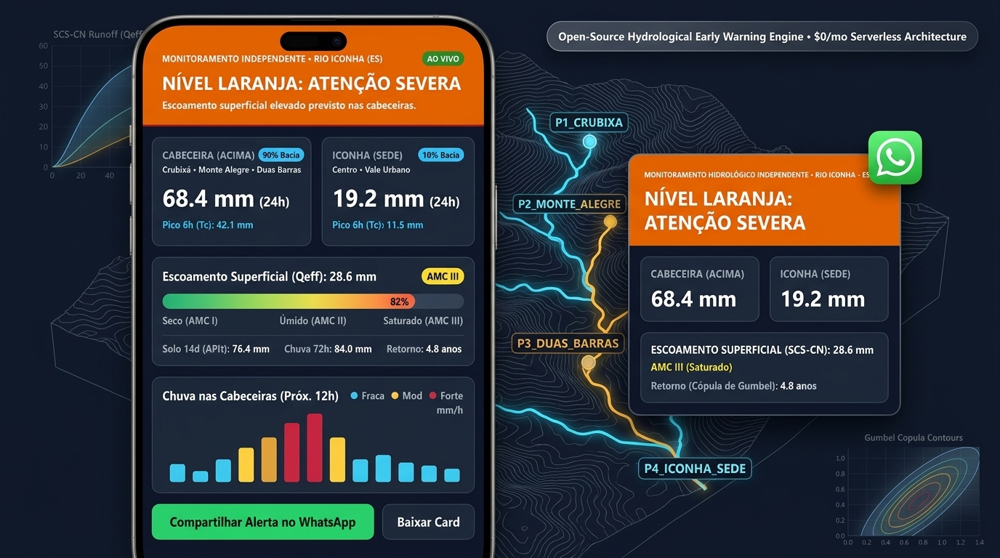
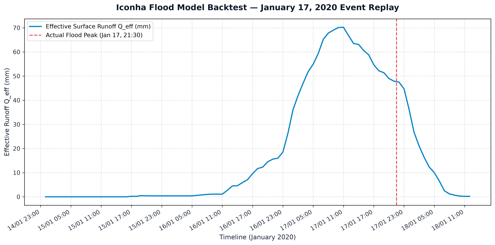

# Iconha Flood & Severe Weather Monitoring System (`iconha-monitoring`)

[](https://github.com/mArBiaN1337/iconha-monitoring/actions)
[](https://www.python.org/)
[](https://docs.astral.sh/uv/)
[-4285F4?style=flat-square&logo=googlecloud&logoColor=white)](https://cloud.google.com/free)
[](LICENSE)



*An **independent, open-source hydrological early warning engine** providing real-time mobile web dashboards and automated WhatsApp alert cards for the Rio Iconha watershed (Espírito Santo, Brazil) — engineered to operate continuously at **$0.00/month** infrastructure cost.*

> **Disclaimer:** `iconha-monitoring` is an independent, community-driven open-source research and civic-tech initiative. It is **not** an official government, municipal, or Civil Defense (*Defesa Civil*) platform, and should be used as a supplementary situational-awareness tool alongside official emergency directives.

---

## Motivation

### Topographical Vulnerability of the Rio Iconha Basin
The municipality of **Iconha**, located in southern Espírito Santo, Brazil, sits at the lowland outlet of the **Rio Iconha watershed**. The basin's upper headwaters originate in the steep crystalline escarpments of **Alfredo Chaves** (*Crubixá* and *Monte Alegre* at elevations exceeding $600\text{–}900\text{ m}$), funneling rapidly through the middle-valley bottleneck of **Duas Barras** before reaching the urbanized floodplain of **Iconha Sede**.

Because of this steep orographic gradient and narrow valley geometry:
1. **Convective & Orographic Amplification:** Moisture-laden Atlantic air masses forced up the mountain scarp trigger intense localized cloudbursts in the headwaters, even when skies over the coastal urban center appear calm.
2. **Short Time of Concentration ($T_c$):** With steep slopes and shallow mountain soils, surface runoff converges into the main channel within **3 to 6 hours**, leaving downstream residents dangerously little lead time before flash flood waves arrive.

### Closing the Civic-Tech Gap
Traditional municipal flood warning infrastructures rely on high-capital physical telemetric networks, proprietary SCADA servers, and recurring cloud database expenditures that small municipalities struggle to procure or maintain over decades.

`iconha-monitoring` bridges this gap by **democratizing operational hydrology**. By coupling open meteorological reanalysis/forecast APIs, physically based soil-moisture accounting, and bivariate Extreme Value Theory inside a **100% serverless, zero-cost ("Always Free Tier")** cloud architecture, any vulnerable watershed can deploy a scientifically rigorous early warning system with zero recurring budget.

---

## What It Basically Does

The system implements a **"Compute-Once, Read-Many" static serverless pipeline** that eliminates per-visitor database queries and guarantees infinite read scalability during emergencies:

```
┌──────────────────────────┐      OIDC Trigger (*/30 * * * *)      ┌───────────────────────────────────┐
│  Google Cloud Scheduler  │ ────────────────────────────────────► │   Google Cloud Run Function       │
└──────────────────────────┘                                       │   (Python 3.12 Hydrological Core) │
                                                                   └─────────────────┬─────────────────┘
                                                                                     │
                     ┌───────────────────────────────────────────────────────────────┼───────────────────────────────────────────┐
                     ▼                                                               ▼                                           ▼
     ┌───────────────────────────────┐                               ┌───────────────────────────────┐           ┌───────────────────────────────┐
     │  1. Multi-Node Ingestion      │                               │  2. Dual Decision Engine      │           │  3. Artifact Publishing       │
     │  Open-Meteo 14d Past + 48h    │                               │  • Dynamic USDA SCS-CN (Q_eff)│           │  • status.json (Telemetry)    │
     │  Forecast across 4 Basin Nodes│                               │  • GPD + Gumbel Copula (T_j)  │           │  • card_whatsapp.png (Pillow) │
     └───────────────────────────────┘                               └───────────────────────────────┘           └───────────────┬───────────────┘
                                                                                                                                 │
                                                                                                                                 ▼
                                                                                                                 ┌───────────────────────────────┐
                                                                                                                 │  Google Cloud Storage (us-east1)
                                                                                                                 │  • Zero-Typing Mobile PWA     │
                                                                                                                 │  • localStorage Offline Cache │
                                                                                                                 │  • 1-Tap WhatsApp Sharing     │
                                                                                                                 └───────────────────────────────┘
```

1. **Automated 30-Minute Execution:** A **Google Cloud Scheduler** cron job (`*/30 * * * *`) dispatches an OIDC-authenticated request to a private **Python 3.12 Google Cloud Run Function** (`iconha-monitoring-engine`).
2. **Spatially Weighted Elevation Grid:** The engine ingests 14 days (336 hours) of antecedent hourly precipitation and 48 hours of forecast data from the **Open-Meteo API** (alongside official Brazilian CEMADEN/ANA/INMET station cross-checks) across **4 spatially weighted nodes** along the watershed's elevation profile, assigning **90% of the basin weight** to the upstream headwaters and middle valley:

| Node ID | Basin Location | Hydrological Zone | Coordinates (Lat, Lon) | Basin Weight ($w_i$) | Base Curve Number ($CN_{II}$) | Kinematic Wave Lag ($\tau_i$) |
| :--- | :--- | :--- | :--- | :---: | :---: | :---: |
| `P1_CRUBIXA` | Crubixá (Alfredo Chaves) | Upper Headwaters (North) | `-20.6400, -40.8600` | **0.35** | `79.0` | **3h** (~22 km) |
| `P2_MONTE_ALEGRE` | Alto Rib. Monte Alegre | Upper Headwaters (West) | `-20.6850, -40.9100` | **0.30** | `80.0` | **3h** (~18 km) |
| `P3_DUAS_BARRAS` | Duas Barras (Confluence) | Middle Valley Bottleneck | `-20.7291, -40.8822` | **0.25** | `78.0` | **1h** (~10 km) |
| `P4_ICONHA_SEDE` | Iconha Sede (Urban Center) | Lower Floodplain | `-20.7928, -40.8108` | **0.10** | `85.0` | **0h** (Outlet) |

3. **Artifact Generation (`status.json` + WhatsApp Card):** After evaluating distributed and routed basin runoff, hydrological trajectory (`RISING`, `PEAKING`, `RECEDING`, or `STABLE`), peak 6-hour arrival windows, and joint return periods, the backend serializes a lightweight `status.json` telemetry payload and renders a high-contrast $1080 \times 1080\text{ px}$ **WhatsApp warning card (`card_whatsapp.png`)** in memory via **Pillow** (with `@lru_cache` TrueType font caching and zero heavy plotting dependencies in production), pushing both to a public **Google Cloud Storage** bucket in `us-east1`.
4. **Offline-Resilient Zero-Typing PWA:** The frontend (`web/`) is a vanilla HTML/CSS/ES Module Progressive Web App requiring zero text input or user configuration. It features:
   - **Observed vs. Forecasted Separation:** Side-by-side comparison of already fallen rain (`Já Choveu 72h`) against upcoming 24h & 6h peak forecasts, plus a split 12-hour headwater bar chart (**3h Observed + `"AGORA"` boundary + 9h Forecast**).
   - **Trajectory & Stale-Data Guardrails:** Real-time trend badges (`↗ Subindo`, `⚠ Pico 6h`, `↘ Recuando`), 5-minute background auto-refresh aligned with GCS edge cache slots (`?v=slot`), and automatic high-contrast warnings whenever cached or server data exceeds **2 hours** of age.
   - **Touch-First Accessibility & 1-Tap WhatsApp Sharing:** Tap-to-explain hydrological indicators for mobile screens and **1-tap native Web Share (`navigator.share`)** to forward the visual alert card across community WhatsApp groups.

---

## How It Was Calibrated (Historical Backtesting)

An operational flood warning engine must balance **early lead time** against **alert fatigue (false positives)**. A naive rainfall threshold triggers false alarms during dry-season storms (when dry mountain soils easily absorb $40\text{ mm}$ of rain) while under-predicting flash floods when moderate rain falls on already saturated slopes.

### ERA5 Reanalysis & Multi-Year Calibration
To ground the engine in physical reality, historical hourly precipitation series (`2015–2025`) from the **ECMWF ERA5 meteorological reanalysis archive** were extracted across the Rio Iconha headwaters (`scripts/calibrate_copula.py`). Non-overlapping 6-hour hydrological blocks ($1,460\text{ events/year}$) were processed to fit the marginal tail distributions of both 6-hour storm intensity ($P_{6h}$) and 14-day antecedent soil moisture ($API_t$), alongside their upper-tail dependence parameter ($\theta$) via Kendall's rank correlation ($\tau$).

### Backtesting Against the January 2020 Iconha Disaster & Impact on Model Parametrization
On the night of **January 17, 2020**, an extreme orographic cloudburst over the headwaters of Alfredo Chaves and Iconha unleashed one of the most destructive flash floods in Espírito Santo's history, rapidly submerging Iconha's commercial and residential center.



Using `scripts/backtest_jan2020.py`, the hydrological engine was replayed hour-by-hour across the January 1–19, 2020 reanalysis timeline. Rather than treating model constants as arbitrary textbook defaults, the January 2020 event replay directly shaped four foundational aspects of the engine's parametrization:

1. **Spatial Headwater Weighting ($90\%$ Upstream Bias), Kinematic Wave Routing ($\tau_i$), & Distributed Runoff Integration:**
   Coarse meteorological grids ($\sim 25\text{ km}$ ERA5 resolution) smooth out localized convective cloudbursts forced by the steep crystalline escarpments of Alfredo Chaves ($600\text{–}900\text{ m}$ elevation drop into the Duas Barras valley bottleneck). Replaying the January 2020 storm demonstrated that lowland rainfall measurements at Iconha Sede severely underestimated total basin inflow, and that averaging precipitation across nodes *before* applying the convex SCS-CN equation diluted localized cloudbursts (Jensen's Inequality). This directly drove:
   - The **90% upstream spatial weight distribution** (`P1_CRUBIXA` $0.35$, `P2_MONTE_ALEGRE` $0.30$, `P3_DUAS_BARRAS` $0.25$) versus only **10%** at `P4_ICONHA_SEDE`, integrating distributed point-level runoff ($\sum w_i Q_{eff,i}$) alongside kinematic wave lag times ($\tau_1 = 3\text{h}, \tau_2 = 3\text{h}, \tau_3 = 1\text{h}, \tau_4 = 0\text{h}$) to capture flood waves already in transit from the upper scarp.
   - Evaluating the fast convective trigger ($P_{6h,\max}$) across a cross-boundary window straddling $t_0$ ($[t_0 - 5\text{h}, t_0 + 24\text{h}]$) on the `upper` and `middle` headwater zones (`decision.py`), paired with bounded convective probability enhancement in live forecasts and a $2.0\times$ convective orographic scaling factor (`--scale 2.0`) when replaying coarse reanalysis archives.
2. **14-Day Soil Memory Decay ($k_{\text{daily}} = 0.88$), Smooth Hill AMC Saturation, & Tropical Initial Abstraction ($\lambda = 0.05$):**
   Before the catastrophic cloudburst on January 17, intermittent rainfall had already moistened the upper watershed. Backtesting with a static Curve Number ($CN_{II}$) and textbook midwestern US agricultural abstraction ($I_a = 0.20 S$) either caused false alarms during isolated dry-spell showers or delayed runoff onset on steep mountain slopes. Calibrating the 336-hour recursive decay factor to $k_{\text{daily}} = 0.88$ ($k_{\text{hourly}} \approx 0.99468$), adopting a **tropical steep-escarpment initial abstraction ratio of $\lambda = 0.05$ ($I_a = 0.05 S$)**, and introducing a **$C^\infty$ smooth Hill saturation curve** ($API_{50} = 40.0\text{ mm}, \gamma = 2.2$) between $CN_I$ and $CN_{III}$ eliminated derivative kinks and premature saturation clamping above $75\text{ mm}$.
3. **Dual Time-Window Deterministic Runoff Thresholds ($Q_{eff,24h}$ & $Q_{eff,6h}$) & De-Escalation Hysteresis:**
   As shown in the backtest hydrograph above, Effective Surface Runoff ($Q_{eff,24h}$) broke above $0\text{ mm}$ on January 15–16, crossed the **Amarelo** runoff threshold ($8.0\text{ mm}$) around `16/01 17:00 BRT`, surged past the **Laranja** ($23.0\text{ mm}$) and **Vermelho** ($34.0\text{ mm}$) cutoffs between `17/01 00:00` and `01:00 BRT`, and peaked at $\sim 70.2\text{ mm}$ around `17/01 11:00 BRT` — providing a critical **20.5-hour forecast lead window** ahead of the actual **21:30 BRT flood peak** in Iconha Sede (red dashed line) while sustaining high runoff ($> 47\text{ mm}$) right through impact. Pairing the 24-hour accumulation cutoff ($Q_{eff,24h} \ge 34.0\text{ mm}$) with a calibrated fast 6-hour Time-of-Concentration cutoff ($Q_{eff,6h} \ge 24.0\text{ mm}$ for **Vermelho**, $15.0\text{ mm}$ for **Laranja**, $5.0\text{ mm}$ for **Amarelo**) and a **10% stateless deadband hysteresis buffer** prevents alert flickering while capturing sudden 6-hour headwater cloudbursts.
4. **Heavy-Tail GPD Shape ($\xi_{P_{6h}} = 0.197$) & Log-Survival Bivariate Copula Return Period Cutoffs ($T_{joint}$):**
   Fitting the 2015–2025 ERA5 series (including the January 2020 anomaly) via `scripts/calibrate_copula.py` yielded a positive Fréchet tail shape parameter for 6-hour headwater rainfall ($\xi_{P_{6h}} = 0.197$, $u = 6.40\text{ mm}$, $\sigma = 5.74$) and an upper-tail Gumbel-Hougaard coupling parameter of $\theta = 1.326$. Replaying the January 15–18 timeline against this joint surface (evaluated in log-survival space via `log1p`/`expm1` to prevent floating-point underflow) anchored the operational return-period boundaries at **$T_{joint} \ge 1.2\text{ yr}$ (Amarelo)**, **$\ge 2.0\text{ yr}$ (Laranja)**, and **$\ge 9.0\text{ yr}$ (Vermelho)**.

#### Operational Severity Tiers (`decision.py`)

| Risk Tier | Alert Level | Escalation Trigger Conditions (Deterministic **OR** Probabilistic) | Operational Meaning |
| :--- | :--- | :--- | :--- |
| 🟢 **VERDE** | Normalcy | $Q_{eff,24h} < 8.0\text{ mm}$ **and** $Q_{eff,6h} < 5.0\text{ mm}$ **and** $API_t < 60.0\text{ mm}$ **and** $T_{joint} < 1.2\text{ yr}$ | Safe soil infiltration; normal river baseflow. |
| 🟡 **AMARELO** | Observation | $Q_{eff,24h} \ge 8.0\text{ mm}$ **or** $Q_{eff,6h} \ge 5.0\text{ mm}$ **or** $API_t \ge 60.0\text{ mm}$ **or** $T_{joint} \ge 1.2\text{ yr}$ | Wet basin soils or moderate headwater rainfall; monitor updates. |
| 🟠 **LARANJA** | Severe Attention | $Q_{eff,24h} \ge 23.0\text{ mm}$ **or** $Q_{eff,6h} \ge 15.0\text{ mm}$ **or** $T_{joint} \ge 2.0\text{ yr}$ | High surface runoff in headwaters; rapid river rise likely. |
| 🔴 **VERMELHO** | Maximum Alert | $Q_{eff,24h} \ge 34.0\text{ mm}$ **or** $Q_{eff,6h} \ge 24.0\text{ mm}$ **or** $T_{joint} \ge 9.0\text{ yr}$ | Extreme flash flood imminent; seek high ground immediately. |

*(Note: Downward tier de-escalation applies a **10% deadband hysteresis factor (`0.90x`)** against the previous active tier stored in `status.json` to prevent alert flickering when metrics hover near a boundary.)*

---

## Mathematical Background (The Dual Decision Engine)

Rather than relying on a single heuristic, `iconha-monitoring` evaluates watershed hazard through two independent, parallel mathematical frameworks inside `src/iconha_monitoring/hydrology/`: a **Deterministic Soil-Runoff Path** and a **Probabilistic Extreme Value Path**.

### Core Hydrological State Variables

Before evaluating the two paths, the engine computes two fundamental state variables for each node $i \in \lbrace 1, 2, 3, 4 \rbrace$ and aggregates them using the spatial basin weights $w_i$:

#### 1. State Variable 1 — Slow Soil Memory ($API_t$)
A 14-day ($336\text{-hour}$) recursive **Antecedent Precipitation Index** that models continuous soil drainage and saturation decay. Given a daily recession constant $k_{\text{daily}} = 0.88$, the hourly decay factor is derived as:

$$
k_{\text{hourly}} = \left(k_{\text{daily}}\right)^{1/24} = 0.88^{1/24} \approx 0.99468
$$

Over the rolling 336-hour historical window, soil moisture memory evolves recursively at each hour $t$:

$$
API_t = k_{\text{hourly}} \cdot API_{t-1} + P_t
$$

#### 2. State Variable 2 — Fast Convective Trigger ($P_{6h,\max}$) & Kinematic Wave Routing
To capture intense cloudbursts matching the watershed's Time of Concentration ($T_c = 6\text{ hours}$) without severing storms that straddle the current clock hour $t_0$, the engine evaluates rolling 6-hour accumulations across a cross-boundary window $t \in [t_0 - 5\text{h},\; t_0 + 24\text{h}]$ as well as the kinematically lagged upstream wave arriving at the valley bottleneck ($\tau_1 = 3\text{h}, \tau_2 = 3\text{h}, \tau_3 = 1\text{h}$):

$$
P_{\text{routed}}(t) = \sum_{i \in \lbrace 1, 2, 3 \rbrace} \left(\frac{w_i}{0.90}\right) P_i(t - \tau_i), \qquad P_{6h,\max} = \max_{t \in [t_0 - 5, t_0 + 18]} \left( \sum_{\tau = t}^{t + 5} P_{\tau} \right)
$$

---

### Path 1: Deterministic Engine — Dynamic USDA SCS Curve Number (`scs_cn.py`)

The deterministic path quantifies how much rainfall fails to infiltrate the mountain soil and becomes **Effective Surface Runoff ($Q_{eff}$, in $\text{mm}$)** using the **USDA Soil Conservation Service Curve Number (SCS-CN)** method, enhanced with a smooth Hill saturation curve, tropical initial abstraction ($\lambda = 0.05$), and distributed point-runoff integration.

#### 1. Hawkins et al. (1985) AMC Boundary Conversions
From the node or basin baseline Curve Number $CN_{II}$ (representing average soil moisture), the dry-soil boundary ($CN_I$, AMC I) and saturated-soil boundary ($CN_{III}$, AMC III) are computed analytically:

$$
CN_I = \frac{4.2 \cdot CN_{II}}{10.0 - 0.058 \cdot CN_{II}}, \qquad CN_{III} = \frac{23.0 \cdot CN_{II}}{10.0 + 0.13 \cdot CN_{II}}
$$

#### 2. Smooth $C^\infty$ Hill Saturation Curve for $CN(API_t)$
Instead of discrete step-function jumps or piecewise linear kinks that prematurely clamp saturation at $75\text{ mm}$, `scs_cn.py` interpolates the effective Curve Number $CN(API_t)$ smoothly across $[CN_I, CN_{III}]$ via a Hill saturation function ($API_{50} = 40.0\text{ mm}$, shape $\gamma = 2.2$):

$$
CN(API_t) = CN_I + \left(CN_{III} - CN_I\right) \cdot \frac{API_t^{\gamma}}{API_{50}^{\gamma} + API_t^{\gamma}}
$$

with physical soil-moisture regime labels: **AMC I ($API_t < 28\text{ mm}$)**, **AMC II ($28 \le API_t < 58\text{ mm}$)**, **AMC II–III ($58 \le API_t < 85\text{ mm}$)**, and **AMC III ($API_t \ge 85\text{ mm}$)**.

#### 3. Potential Maximum Soil Retention ($S$), Tropical Abstraction ($I_a = 0.05 S$), & Distributed Runoff ($Q_{eff}$)
Given the dynamic Curve Number $CN(API_t)$, the potential maximum soil moisture retention $S$ (in $\text{mm}$) and tropical steep-escarpment initial abstraction $I_a = \lambda S$ ($\lambda = 0.05$) are evaluated as:

$$
S = \frac{25400}{CN(API_t)} - 254, \qquad I_a = 0.05 \cdot S
$$

For a given precipitation accumulation $P$ (evaluated over both the $24\text{-hour}$ forecast and the $6\text{-hour}$ $T_c$ window), node-level Effective Surface Runoff $Q_{eff,i}$ is obtained via the SCS runoff equation and integrated across the 4 nodes to prevent Jensen's Inequality spatial dilution:

$$
Q_{eff}(P, S) = \begin{cases}
0 & \text{if } P \le I_a \\
\dfrac{(P - I_a)^2}{P + 0.95 \cdot S} & \text{if } P > I_a
\end{cases}, \qquad Q_{eff,\text{basin}} = \max\left(\sum_{i=1}^{4} w_i \, Q_{eff,i},\;\; Q_{eff}(\bar{P}, \overline{API}_t)\right)
$$

---

### Path 2: Probabilistic Engine — EVT Peaks-Over-Threshold GPD & Gumbel-Hougaard Copula (`copula_gpd.py`)

Compound flash floods are bivariate phenomena: a moderate storm on saturated soil or an extreme cloudburst on moderately moist soil can produce catastrophic synergy. The probabilistic path applies **Extreme Value Theory (EVT)** to compute the **Joint Return Period ($T_{joint}$, in years)** of simultaneously observing a 6-hour convective burst $P_{6h,\max}$ and an antecedent soil moisture state $API_t$.

#### 1. Peaks-Over-Threshold (POT) Generalized Pareto Distribution (GPD) Survival Marginals
For each random variable $X \in \lbrace P_{6h,\max}, API_t \rbrace$ with pre-calibrated 95th-percentile threshold $u$ (exceedance rate $\lambda_u = 0.05$), scale parameter $\sigma > 0$, and tail shape parameter $\xi$, the upper-tail survival (exceedance) probability $\bar{F}_X(x) = 1 - F_X(x)$ for tail events ($x > u$) is modeled by a **Generalized Pareto Distribution**:

$$
\bar{F}_X(x) = \begin{cases}
\lambda_u \left(1 + \xi \left(\dfrac{x - u}{\sigma}\right)\right)^{-1/\xi} & \text{for } \xi \neq 0 \\
\lambda_u \exp\left(-\dfrac{x - u}{\sigma}\right) & \text{for } \xi = 0
\end{cases}
$$

Letting $\bar{u}_1 = \bar{F}_{P_{6h}}(P_{6h,\max})$ and $\bar{v}_1 = \bar{F}_{API}(API_t)$ denote the marginal exceedance probabilities (with $u_1 = 1 - \bar{u}_1$ and $v_1 = 1 - \bar{v}_1$), the engine next evaluates their joint tail behavior in log-survival space.

#### 2. Log-Survival Bivariate Gumbel-Hougaard Copula
Because extreme convective storms and wet-season soil saturation exhibit strong **upper-tail dependence** (they co-occur during persistent South Atlantic Convergence Zone — *ZCAS* — episodes), their joint cumulative distribution is coupled via the **Gumbel-Hougaard extreme-value copula** with dependence parameter $\theta \ge 1$ ($\theta = 1.326$ calibrated for the Rio Iconha headwaters):

$$
A_{\theta}(\bar{u}_1, \bar{v}_1) = \left[ \left(-\operatorname{log1p}(-\bar{u}_1)\right)^{\theta} + \left(-\operatorname{log1p}(-\bar{v}_1)\right)^{\theta} \right]^{1/\theta}, \qquad C_{\theta}(u_1, v_1) = \exp\left(-A_{\theta}(\bar{u}_1, \bar{v}_1)\right)
$$

#### 3. Numerically Stable Joint Exceedance Probability & Return Period ($T_{joint}$)
To prevent catastrophic floating-point subtraction cancellation when $u_1, v_1 \to 1$ ($\bar{u}_1, \bar{v}_1 \to 0$), the **joint exceedance probability** $p_{\text{joint}} = 1 - u_1 - v_1 + C_{\theta}(u_1, v_1)$ is evaluated directly via $\operatorname{expm1}$:

$$
p_{\text{joint}} = \max\left(10^{-12},\quad \bar{u}_1 + \bar{v}_1 + \operatorname{expm1}\left(-A_{\theta}(\bar{u}_1, \bar{v}_1)\right),\quad \bar{u}_1 \cdot \bar{v}_1\right)
$$

Given $N_{\text{yr}} = 1,460$ non-overlapping 6-hour observation blocks per year, the **Bivariate Joint Return Period ($T_{joint}$, in years)** is:

$$
T_{\text{joint}} = \max\left(0.1,\quad \frac{1}{N_{\text{yr}} \cdot p_{\text{joint}}}\right)
$$

Pre-calibrated parameters stored in `src/iconha_monitoring/hydrology/copula_params.json`:
- **6-Hour Rainfall Marginal ($P_{6h}$):** $u = 6.40\text{ mm}$, $\sigma = 5.74$, $\xi = 0.197$
- **Antecedent Moisture Marginal ($API_t$):** $u = 103.49\text{ mm}$, $\sigma = 27.47$, $\xi = 0.069$
- **Upper-Tail Coupling:** $\theta = 1.326$, $\lambda_u = 0.05$, $N_{\text{yr}} = 1460.0\text{ events/yr}$

---

## Repository Structure

```text
iconha-monitoring/
├── src/iconha_monitoring/
│   ├── config.py                  # Spatial grid weights, CN_II bases, and tier definitions
│   ├── pipeline.py                # End-to-end Cloud Run Function orchestrator
│   ├── hydrology/
│   │   ├── state_vars.py          # Recursive 336h API_t and rolling 6h Tc accumulators
│   │   ├── scs_cn.py              # Dynamic USDA SCS-CN runoff calculator (Hawkins AMC I-III)
│   │   ├── copula_gpd.py          # POT GPD marginals + Gumbel-Hougaard Copula engine
│   │   ├── copula_params.json     # ERA5-calibrated EVT & Copula parameters
│   │   └── decision.py            # Dual Decision Engine & 4-tier classifier
│   ├── ingestion/
│   │   ├── open_meteo.py          # Multi-coordinate Open-Meteo API client
│   │   └── telemetry.py           # Official Brazilian telemetry (ANA/CEMADEN/INMET) integration
│   ├── renderer/
│   │   ├── json_builder.py        # Builds status.json contract for the PWA
│   │   └── whatsapp_card.py       # Pillow 1080x1080 visual alert card generator
│   └── storage/
│       └── gcs.py                 # Google Cloud Storage publisher (local fallback in dev)
├── web/                           # Zero-typing static mobile PWA (Vanilla HTML/CSS/JS)
├── scripts/
│   ├── dev.py                     # Local development pipeline runner & static server
│   ├── calibrate_copula.py        # Offline ERA5 GPD/Copula parameter calibration (SciPy)
│   └── backtest_jan2020.py        # Historical replay & Matplotlib verification of Jan 2020 flood
├── tests/                         # Unit and integration test suite (pytest)
└── pyproject.toml                 # Project metadata and uv dependencies
```

---

## Quickstart & Local Development

### Prerequisites
- **Python 3.12+** (`requires-python >= 3.11`)
- [**uv**](https://docs.astral.sh/uv/) (fast Python package and environment manager), which automatically resolves and installs the project dependencies defined in `pyproject.toml`:
  - **Runtime Dependencies:**
    - `functions-framework>=3.10.2` — Google Cloud Run Functions HTTP runtime and local invocation wrapper
    - `google-cloud-storage>=2.18.0` — Publishes `status.json` and `card_whatsapp.png` to the GCS bucket
    - `pillow>=10.4.0` — In-memory $1080 \times 1080$ PNG rendering for the WhatsApp warning card (with `@lru_cache` TrueType font handle caching)
    - `requests>=2.32.0` — Resilient HTTP client with exponential retry/backoff for Open-Meteo and Brazilian telemetry APIs
    - `tzdata>=2026.6` — IANA timezone database (`America/Sao_Paulo`)
  - **Development & Offline Calibration Dependencies (`[dependency-groups.dev]`):**
    - `matplotlib>=3.11.2` — Used strictly offline in `scripts/backtest_jan2020.py` for hydrological time-series verification charts (decoupled from the production container to save $>120\text{ MB}$ of image size and cold-start overhead)
    - `pytest>=8.3.0` — Unit and integration test runner
    - `scipy>=1.14.0` — Used strictly offline in `scripts/calibrate_copula.py` to fit GPD marginals and Kendall's $\tau$

### 1. Clone & Synchronize Dependencies
```bash
git clone https://github.com/mArBiaN1337/iconha-monitoring.git
cd iconha-monitoring
uv sync
```

### 2. Run the Unit Test Suite
```bash
uv run pytest -v
```

### 3. Run the Local Pipeline & PWA Development Server
Execute the complete hydrological pipeline locally (generating `status.json` and `card_whatsapp.png` on disk) and launch the local web server:
```bash
uv run python scripts/dev.py
```

### 4. Reproduce the January 2020 Flood Backtest
Fetch the historical January 2020 ERA5 reanalysis series and generate the validation hydrograph in `imgs/backtest_jan2020_result.png`:
```bash
MPLBACKEND=Agg uv run python scripts/backtest_jan2020.py
```
*(On Windows PowerShell: `$env:MPLBACKEND='Agg'; uv run python scripts/backtest_jan2020.py`)*

---

## Zero-Cost Cloud Architecture Constraint ($0.00/Month)

A foundational engineering rule of `iconha-monitoring` is **100% adherence to Google Cloud's Always Free Tier**:
- **Region Pinning (`us-east1`) & Edge-Cache Slot Alignment:** All storage and compute resources run strictly in `us-east1` to qualify for the Always Free 5 GB Google Cloud Storage allowance (5,000 Class A writes and 50,000 Class B reads/month). Running every 30 minutes consumes only $2 \times 24 \times 30 = 1,440$ Class A writes/month per artifact, and the frontend quantizes requests to 5-minute cache slots (`?v=slot`) matching `Cache-Control: public, max-age=300` so concurrent user traffic during storms is served from Google's edge cache rather than consuming raw Class B bucket reads.
- **No Runtime Heavy SciPy / Matplotlib / NumPy Dependencies:** Parameter fitting (`scipy.stats.genpareto`) and historical hydrograph plotting (`matplotlib`) are strictly decoupled into the offline scripts (`scripts/calibrate_copula.py` and `scripts/backtest_jan2020.py`). The production Cloud Run Function evaluates the GPD and Gumbel-Hougaard Copula using pure Python standard-library `math` routines (`log1p`, `expm1`) and renders cards via cached Pillow font handles, keeping container images $>120\text{ MB}$ smaller and cold-start memory footprints minimal.
- **Private Compute Endpoint:** The Cloud Run Function (`iconha-monitoring-engine`) is deployed with `--no-allow-unauthenticated` and triggered exclusively via OIDC tokens from Cloud Scheduler, preventing billing abuse or denial-of-wallet attacks.

---

## Contributing & License

Contributions from hydrologists, meteorologists, civic-tech developers, and local community members are warmly welcomed! Feel free to open an issue or submit a pull request to improve the calibration, add regional station adapters, or adapt this engine for other flash-flood-prone watersheds.

Distributed under the **MIT License**. See `LICENSE` for full details.
